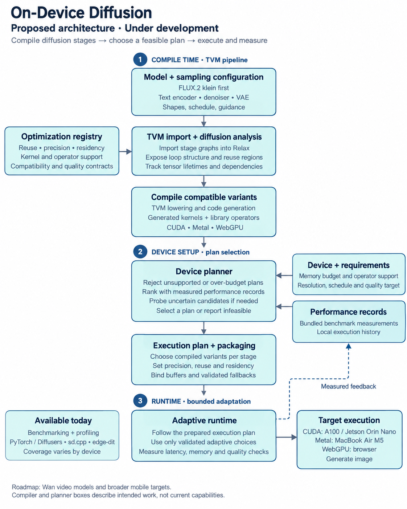

# On-Device Diffusion

Efficient diffusion inference across GPUs, edge devices, and browsers.

[Project overview](wiki/project/overview.md) · [Experiments](wiki/experiments.md) · [Roadmap](wiki/project/milestones.md) · [Contribute](#contributing)

## About

We are researching how to run diffusion models efficiently under limited memory and compute.
The goal is a diffusion-aware compiler and runtime planner that jointly chooses **computation
reuse, precision, and memory placement** to reduce latency while meeting a declared quality requirement.

**This project is under active development.** The repository currently provides benchmarking,
profiling, and experiment records. The compiled pipeline and planner are being developed;
they are not yet a ready-to-use inference engine.

## Current focus

| Area | Status |
|---|---|
| FLUX.2 klein, distilled and Base | A100 and Jetson Orin Nano benchmarks, profiling and image-quality evaluation; coverage varies by configuration |
| Existing engines | PyTorch + Diffusers, stable-diffusion.cpp, edge-dit.cpp and Nunchaku/SVDQuant comparisons |
| ShiftAdd and mixed precision | Transformer weight conversion, calibration, mixed-plane image diagnostics and storage comparisons completed; broader allocation experiments are next |
| Packed-weight kernels | Planned integration into an existing engine, investigating Nunchaku first; runtime memory, latency and energy benefits remain to be measured |
| Longer-term compilation and planning | TVM pipeline and joint precision/reuse/residency planner remain longer-term goals; Wan and mobile targets are deferred |

The current semester goal is to complete the ShiftAdd study and an engine-integrated packed-weight
kernel prototype. Next steps include component memory accounting, calibration-based 2–6-plane
allocation, and measured energy per image. See the [weekly plan](wiki/project/milestones.md).

Current ShiftAdd image tests reconstruct weights to BF16 before GPU execution: smaller stored
weights do not yet demonstrate lower GPU memory use or faster inference. See the
[experiment registry](wiki/experiments.md) for configurations, results, failures, and comparison limits.

## Explore the repository

- [ShiftAdd FLUX experiments](shiftadd/README.md) — compressed weights, calibration and image diagnostics.
- [Runners and profiling tools](scripts/README.md) — how the measurements are collected.
- [Configurations](configs/) and [results](results/README.md) — labelled experiments and saved measurements.
- [Research wiki](wiki/index.md) — findings, methods, design decisions, and open questions.

## Contributing

This is a good time to contribute: profiling evidence and feedback can help shape the system.
We especially welcome **FLUX or Wan measurements on edge devices**, including Jetson, Apple silicon,
mobile hardware, and other GPU targets, as well as A100 reference results.

[Open an issue](https://github.com/mfaruqi/on-device-diffusion/issues) to share results, traces, an
optimization experiment, or a reproducibility problem. Useful reports include:

- Hardware and software versions, engine, model/checkpoint, and execution settings.
- Timing and memory measurements, separating first-run, warm-up, and measured generations.
- Quality observations and any failures or limitations, especially when using quantization or caching.

Small, reproducible contributions are welcome. Keep model weights and large traces outside Git;
link to artifacts and include the configuration needed to reproduce them.

## Proposed architecture

View the planned compiler and runtime design

The diagram shows the intended design. Today's benchmarking and profiling work supplies evidence
for the compiler and planner; Wan and broader mobile support remain future work.

  

Click the diagram to view it at full size.

---

Research by Mahad Faruqi at Purdue EcoAI Lab, advised by Prof. Haoran You.
