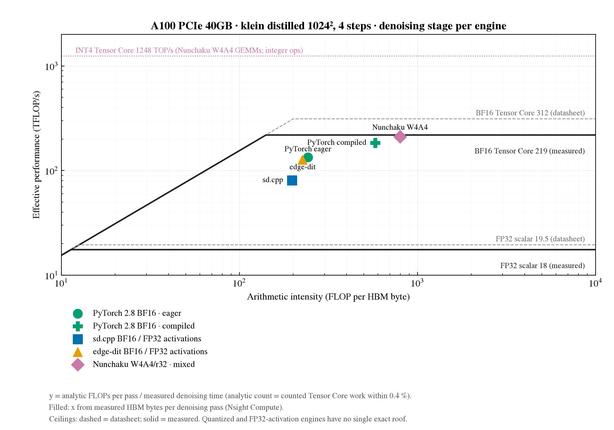
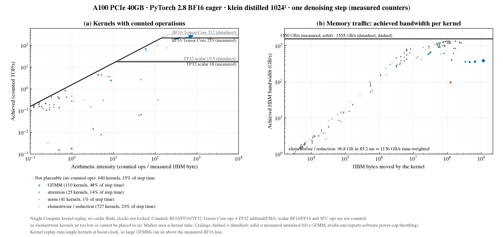

# A100 image hardware-counter capture

Week 3–4 compiler analysis for RQ1 ([scope](../wiki/project/overview.md)). This diagnostic reuses the completed [PyTorch 2.8 BF16 reference](../experiments/a100-flux-klein-torch28-001.md): pinned distilled Klein 4B, 1024², four steps, CFG 1, batch one, seed zero, resident weights, unchanged prompt and attention selection. It does not change an optimization or create a new speed baseline.

## Submission and status

Submitted 2026-10-21 as Slurm **12001684** (failed at the CSV parser after counter access was confirmed); the corrected capture completed on 2026-10-24 as Slurm **12015059** ([record](../experiments/a100-flux-klein-torch28-001.md#hardware-counter-capture-2026-10-24)). Isolated snapshots: `/scratch/gilbreth/mfaruqi/a100-ncu-20261021` and `…-20261024{,b,c}`. The sections below this one describe that eager capture; [engine counter captures](#engine-counter-captures) and [measured ceilings](#measured-ceilings) extend it to the other engines.

[Plan](../configs/a100-flux-klein-torch28-ncu.json), [controller](../scripts/profile_a100_counters.py), [Slurm script](../scripts/gilbreth-counters.slurm). The plan hashes the original run's config and supplies the exact reference image hash and software versions. Generation settings are copied without edits. Profiling controls are recorded separately in `counter-plan.json`.

```bash
# From an isolated snapshot with scripts/, configs/, and the referenced config:
mkdir -p logs
sbatch scripts/gilbreth-counters.slurm
# Check the existing submission:
squeue -j 12001684
sacct -j 12001684 --format=JobID,State,Elapsed,ExitCode
```

Slurm reserves one PCIe A100 (`constraint=G`, `a100-40gb`, account `you139`) for at most six hours (raised from two on 2026-10-24). The controller limits the counter probe to ten minutes (raised from three on 2026-10-24: the probe took 137 s on g001 and exceeded 180 s on g000 before profiling its GEMM) and image capture to 4.5 hours (raised from 90 minutes on 2026-10-24: job 12014773 replayed about 4,160 of roughly 6,700 image kernels, about 46 per minute, before the 90-minute limit). On timeout it terminates its owned process group and preserves partials. Model downloads are disabled; the existing torch28-trt environment is reused, not modified.

## Gates and capture

1. Save device/driver/clock/power information, Nsight version, exact source hashes and supported metric queries.
2. Require matching GPU type, SM80, torch/CUDA runtime/cuDNN, Diffusers and Transformers versions. Driver and clock differences remain in the recorded device snapshots.
3. Profile a tiny warmed BF16 GEMM. Require readable HBM counters and positive BF16 Tensor Core operations. Permission errors or unsupported metrics fail the job before model loading; no alternative counter set is substituted.
4. Load through the existing portable runner, then execute its unchanged first + three warm-ups + ten measured prefix with NCU capture disabled. Require all image hashes to match the saved reference.
5. Enable counters for **one additional complete image**, with NVTX labels for text encoding, each denoising step and VAE decoding. Loading and prefix generations are outside the capture. Capture kernel execution without kernel-name or launch-count filtering.
6. Save the captured PNG and check its hash against the reference. Export the NCU report twice: real kernel names and NVTX stage labels, matched by launch ID. Refuse missing stages/counters or invalid units.

This uses kernel replay, `cache-control=none` and `clock-control=none`: no explicit cache flush or clock override. Replay can still change cache state and serialize execution. These measurements are not a perfect reproduction of uninstrumented traffic or concurrency. See [NVIDIA's CLI documentation](https://docs.nvidia.com/nsight-compute/NsightComputeCli/index.html).

## Outputs and interpretation

The run retains ordinary config/environment/load/runs/stages/summary/status files. The prefix summary is explicitly profiler-attached with capture disabled; it is not a replacement for the saved baseline. The extra captured generation is outside its statistics.

Within `profile/`:
- `probe.ncu-rep`, `probe.csv`, `counter-access.json`: counter permission/execution gate.
- `image.ncu-rep`: full replay report, including raw evidence and NVTX context; binary stays outside Git.
- `counters.csv`, `counter-stages.csv`: unscaled metric exports by launch, plus stage-labelled companion.
- `counter-kernels.json.gz`: validated per-launch values and coordinates, not cross-launch averages.
- `captured-generation.json`: image hash and stage timings under replay, excluded from baseline timing.
- `counter-summary.json`: validated coverage and aggregate counted quantities, with limitations.

HBM traffic is `dram__bytes_read.sum + dram__bytes_write.sum`. Kernel time is `gpu__time_duration.sum` in nanoseconds. Computation records dense BF16, FP16 and TF32 Tensor Core operations with FP32 accumulation, plus predicated FP32 add/multiply/FMA thread-instruction counts (FMA counts twice). The script labels their sum **counted operations**, not total algorithmic FLOPs: scalar FP16, FP64, SFU and integer work are not covered. Zero HBM bytes yield an undefined intensity rather than division by zero. Integer kernels are not converted to floating-point work.

Per-kernel coordinates use counted operations / measured HBM bytes and counted operations / kernel seconds. Keep these separate from [analytic rooflines](roofline-plots.md): tensor hardware work can differ from ideal shape FLOPs. Never divide summed counter work by a baseline stage time and call it a measured kernel point. Summed kernel durations are not stage elapsed time; memcpy/CPU work are excluded from kernel-counter totals. Metric definitions: [baseline metrics](../wiki/methods/baseline-metrics.md#nsight-compute-hardware-counters-a100).

Completed output still requires review before publication; `status.json=complete` and `validation.json` must both pass. A successful probe alone is not a completed image capture. Site counter restrictions require administrator assistance, not an unreviewed privilege change.

## Engine counter captures

[profile_engine_counters.py](../scripts/profile_engine_counters.py) measures DRAM bytes for one steady denoising pass of any engine, without engine or library changes, from a completed benchmark run (the *template*). Plans: [`configs/ncu/`](../configs/ncu/). Each plan names the template run, the launcher, the Nsight Compute binary, a timeout and the analytic FLOPs per pass.

| Launcher | Command under ncu |
|---|---|
| `portable` | `run_flux_portable.py --kind attempt` (PyTorch; `warm_run: true` first fills `torch.compile` caches outside Nsight) |
| `sdcpp` | `run_sdcpp.py --kind attempt` |
| `nunchaku` | `run_nunchaku.py --device a100` |
| `edgedit-direct` | the template's `command.json` binary with `--repeat 2` and new output paths; the runner's NVML/`nvidia-smi` setup hangs under `--target-processes all` |

Procedure: the template config with protocol 1 + 0 + 1 runs twice under `ncu --target-processes all --replay-mode kernel --cache-control none --clock-control none`.

1. **Sequence pass**: every launch with `gpu__time_duration.sum` only. The kernel-name sequence is searched for the denoising period L: among periods that repeat at least steps − 2 times (up to max(3, L/200) differing names, since schedulers launch a step-dependent kernel), the one whose last full repeat carries the most kernel time. A text encoder's layers also repeat, and a compiled step can be shorter than a block of them; the time criterion separates them.
2. **Counter pass**: the full metric list on 1.5 L launches around that repeat (`--launch-skip`, `--launch-count`). The captured names must equal a slice of the sequence at exactly one offset within ±L/4 (one-time setup kernels before the window can differ in number between processes); otherwise the run fails with a record.

Outputs per run: `profile/sequence.csv.gz` (every launch, kernel time), `profile/window.csv`, `profile/pass-kernels.json` (the pass's launches), `profile/counter-summary.json` (bytes per pass, counted ops, intensities, offset), `status.json` (Slurm jobs, the detected period and window, earlier outcomes). Binary `.ncu-rep` files are deleted after export. `--resume <run dir>` re-analyses saved CSVs and reruns only a missing pass:

```bash
sbatch --export=ALL,PLAN=configs/ncu/a100-flux-klein-compile-001-counters.json scripts/gilbreth-engine-counters.slurm
# re-analyse or finish an existing capture:
sbatch --export=ALL,PLAN=configs/ncu/<plan>.json,RESUME=results/runs/<counters run> scripts/gilbreth-engine-counters.slurm
```

The Slurm script uses standby QoS, `constraint=G` and a 3 h 45 min limit. Durations on 2026-10-28/29: sd.cpp 54 min, Nunchaku 19 min, compiled PyTorch 83 min (window rerun 26 min), edge-dit 17 min. Metric definitions: [baseline metrics](../wiki/methods/baseline-metrics.md#nsight-compute-engine-counter-captures-a100). Results: [comparison](../experiments/compare-a100-engine-roofline-measured-20261029.md).



## Measured ceilings

[measure_ceilings_cuda.py](../scripts/measure_ceilings_cuda.py) ([config](../configs/a100-ceilings.json), [Slurm script](../scripts/gilbreth-ceilings.slurm), about 4 minutes) measures bandwidth and dense GEMM throughput per precision and writes `hardware-override.json`. Record: [a100-ceilings-001](../experiments/a100-ceilings-001.md).

```bash
sbatch scripts/gilbreth-ceilings.slurm
```

## Measured roofline figures

[plot_roofline_measured.py](../scripts/plot_roofline_measured.py) draws (a) the per-kernel roofline of one eager denoising step with achieved bandwidth per kernel and (b) the engine roofline, with every engine's x from its counter capture and solid measured ceilings next to dashed datasheet ceilings. It finds captures automatically (`results/runs/*__counters__*/profile/counter-summary.json`).

```bash
python scripts/plot_roofline_measured.py --ceilings results/runs/a100-ceilings-001__ceilings__20261029-042704 [--upload]
```

`--upload` resumes the W&B run in `output/roofline-a100-measured/wandb-upload.json` and verifies the panels and the artifact digest.


