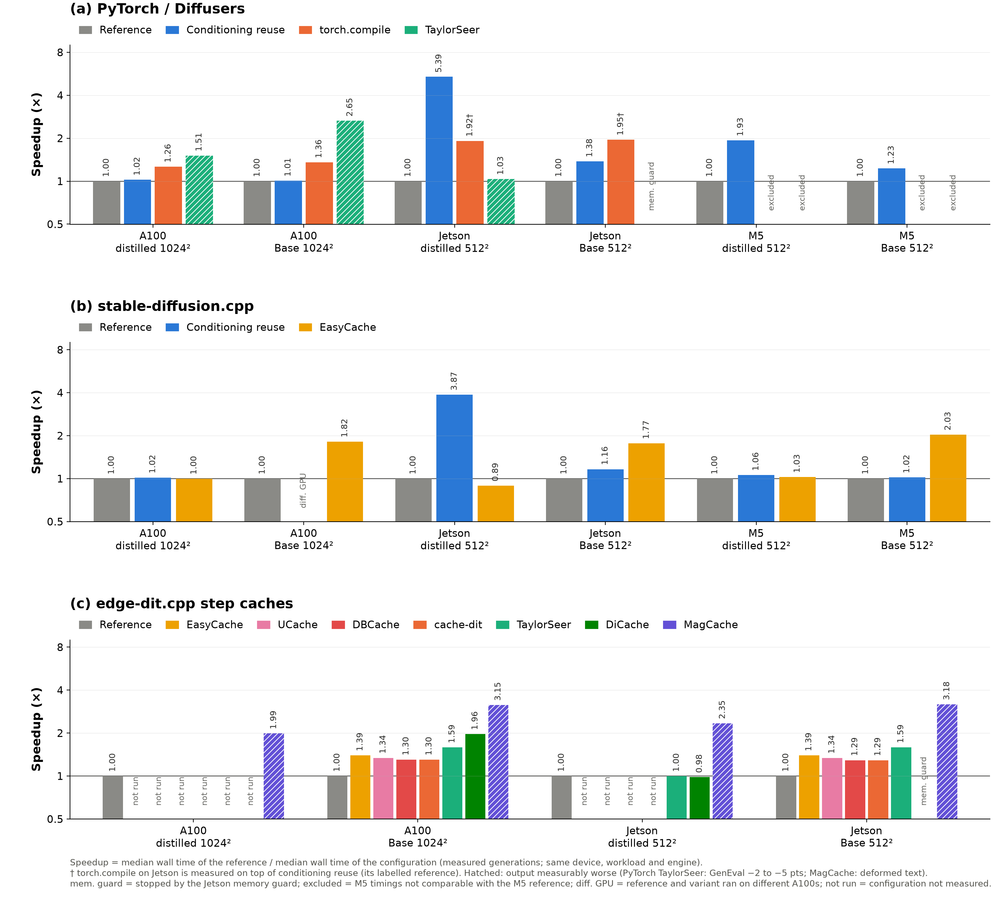

# Performance and Benchmarks (A100 PCIe 40GB, Jetson Orin Nano)

[← Project wiki](../wiki/hot.md) · [metric definitions](../wiki/methods/baseline-metrics.md) · [experiment registry](../wiki/experiments.md)

Benchmark snapshot for FLUX.2 klein 4B text-to-image on two devices, laid out after edge-dit.cpp's [performance (RTX 4090)](https://github.com/THU-MIG/edge-dit.cpp/blob/main/docs/performance-4090.md) page. It reports speed, peak memory and image quality for three runtimes (PyTorch/Diffusers, stable-diffusion.cpp, edge-dit.cpp; Nunchaku on the A100) and their options. Each device section stands alone; cross-device conclusions are in the comparison records linked at the end. Generated by `scripts/make_performance_doc.py` from run files; do not edit the tables by hand.

## How to read these numbers

- **Compare speed with `DiT`** (median denoising-stage time, ms) for runtime efficiency, and **`E2E`** (median `wall_ms`: one generation from prompt to decoded image) for what a user waits. **Model load is excluded** from both (reported in each run's `load.json`), but on the Jetson some configurations reload weights inside every generation by design (sequential residency, disk-backed sd.cpp); that reload is inside `E2E` and is the main difference between those rows.
- **Medians over `n` measured generations** after one first generation and discarded warm-ups; one prompt, seed 0, batch 1. TE = text encoding, VAE = VAE decoding (ms).
- **Same-precision rule:** compare systems only within the same precision column. On the A100 the 16-bit group is PyTorch BF16 / sd.cpp BF16 / edge-dit BF16 weights with FP32 activations; edge-dit Base Q4_0 and Nunchaku W4A4 are compressed checkpoints and are reported separately, never against BF16. On the Jetson all transformers are Q4_0, but text encoders differ (sd.cpp Q4_K_M, edge-dit Q4_K_M with Q8_0 token embedding, PyTorch NF4).
- **⚠** = the option changes the image in a way measured as worse: a paired GenEval interval entirely below zero, or visibly damaged text/content in the benchmark image. **Bold** = the best result in each table (speed: fastest E2E row without ⚠; readout: fastest reference per model; memory: lowest peak per model; quality: highest GenEval per model among rows scored on the largest prompt set; options: largest speedup without ⚠). Speed bold spans precision groups, so read it together with the same-precision rule.
- **Quality:** GenEval is the formal metric (calibration prompts, 4 seeds; Δ is paired against the same system's reference). PSNR/LPIPS compare the single benchmark image with the same system's reference image (∞ = identical pixels). Jetson GenEval rows are A100 generations of the identical Jetson weights and options (quality depends on weights, precision and options, not the device). See [GenEval method](../wiki/methods/baseline-metrics.md#geneval-formal-image-quality-metric).
- **Memory is in GiB.** A100: device-wide used memory peak. Jetson: whole-harness RAM peak including load (CPU and GPU share 7.4 GiB). The two are different quantities and are not compared.

## Test matrix at a glance

| Device | Workloads | Systems | Runs on disk (complete/failed) |
|---|---|---|---|
| A100 PCIe 40GB (Gilbreth) | klein distilled (4 steps) / Base (50 steps, CFG 4), 1024x1024 | PyTorch / Diffusers, stable-diffusion.cpp, edge-dit.cpp, Nunchaku | 85 (75/10) |
| Jetson Orin Nano 8GB (25 W) | klein distilled (4 steps) / Base (50 steps, CFG 4), 512x512 | PyTorch / Diffusers, stable-diffusion.cpp, edge-dit.cpp | 134 (90/42) |

Failed runs include memory-guard stops, out-of-memory placements, smoke tests that failed a gate and interrupted runs; each keeps its config and error in `status.json` and is listed in the [registry](../wiki/experiments.md). Only completed full protocols appear in the tables.

## Speed-up overview

Each option against its own reference on the same device, workload and system (log scale; hatched = output measurably worse; generated by `scripts/plot_speedups.py`, copied to `docs/assets/`). Per-device tables follow.

---

## A100 PCIe 40GB (Gilbreth) — text-to-image (1024x1024)

### Speed: klein distilled (4 steps, CFG 1) (median, ms)

| System | Precision | Budget | Configuration | DiT | E2E | TE | VAE | n |
|---|---|---|---|--:|--:|--:|--:|--:|
| PyTorch / Diffusers | BF16 | GPU-resident | No reuse reference | 981 | 1241 | 47.0 | 165 | 10 |
| PyTorch / Diffusers | BF16 | GPU-resident; torch 2.8.0 | torch 2.8 reference | 1038 | 1290 | 46.2 | 168 | 10 |
| PyTorch / Diffusers | BF16 | GPU-resident; torch 2.8.0 | TaylorSeer cache (output changed) ⚠ | 593 | 854 | 46.4 | 168 | 10 |
| PyTorch / Diffusers | BF16 | GPU-resident; torch 2.8.0 | torch.compile | 758 | 1022 | 46.3 | 172 | 10 |
| PyTorch / Diffusers | BF16 | GPU-resident; torch 2.8.0 | Conditioning reuse | 1042 | 1261 | 0.2 | 169 | 10 |
| stable-diffusion.cpp | BF16 | GPU-resident | No reuse reference | 1726 | 2429 | 65.3 | 606 | 10 |
| stable-diffusion.cpp | BF16 | GPU-resident | Conditioning reuse | 1733 | 2389 | 13.2 | 615 | 10 |
| stable-diffusion.cpp | BF16 | GPU-resident | Prefetch off | 1726 | 2429 | 65.0 | 607 | 10 |
| stable-diffusion.cpp | BF16 | GPU-resident | EasyCache | 1734 | 2436 | 65.1 | 607 | 10 |
| stable-diffusion.cpp | BF16 | GPU-resident | mmap on | 1735 | 2440 | 65.1 | 609 | 10 |
| edge-dit.cpp | BF16 weights / FP32 transformer activations | — | No reuse reference | 1096 | 1641 | — | 270 | 10 |
| edge-dit.cpp | BF16 weights / FP32 transformer activations | — | MagCache (3/4 reused; output degraded) ⚠ | 290 | 826 | — | 273 | 10 |
| **Nunchaku** | SVDQuant W4A4/r32 replacement transformer + BF16 text encoder/VAE | GPU-resident, no reuse | **SVDQuant W4A4/r32** | 663 | **898** | 47.1 | 165 | 10 |

### Speed: klein Base (50 steps, CFG 4) (median, ms)

| System | Precision | Budget | Configuration | DiT | E2E | TE | VAE | n |
|---|---|---|---|--:|--:|--:|--:|--:|
| PyTorch / Diffusers | BF16 | GPU-resident | No reuse reference | 24837 | 25148 | 94.8 | 168 | 10 |
| PyTorch / Diffusers | BF16 | GPU-resident; torch 2.8.0 | torch 2.8 reference | 26171 | 26477 | 93.0 | 170 | 10 |
| PyTorch / Diffusers | BF16 | GPU-resident; torch 2.8.0 | TaylorSeer cache ⚠ | 9672 | 9981 | 92.8 | 170 | 10 |
| **PyTorch / Diffusers** | BF16 | GPU-resident; torch 2.8.0 | **torch.compile** | 19203 | **19525** | 94.5 | 172 | 10 |
| PyTorch / Diffusers | BF16 | GPU-resident; torch 2.8.0 | Conditioning reuse | 26070 | 26290 | 0.4 | 170 | 10 |
| stable-diffusion.cpp | BF16 | GPU-resident | Initial reference | 42923 | 43686 | 119 | 612 | 10 |
| stable-diffusion.cpp | BF16 | GPU-resident | No reuse reference | 43210 | 43976 | 121 | 611 | 10 |
| stable-diffusion.cpp | BF16 | GPU-resident | EasyCache | 23433 | 24193 | 119 | 611 | 10 |
| stable-diffusion.cpp | BF16 | GPU-resident; different physical GPU from reference | Conditioning reuse Different GPU | 43110 | 43767 | 15.1 | 613 | 10 |
| edge-dit.cpp | Q4_0 transformer / Q4_K_M text / BF16 VAE (GGUF) | all resident; untiled | Reference | 48740 | 49428 | 120 | 280 | 10 |
| edge-dit.cpp | Q4_0 transformer / Q4_K_M text / BF16 VAE (GGUF) | all resident; untiled | MagCache (sign garbled) ⚠ | 14890 | 15708 | 120 | 280 | 10 |
| edge-dit.cpp | Q4_0 transformer / Q4_K_M text / BF16 VAE (GGUF) | all resident; untiled | DiCache | 24400 | 25154 | 120 | 280 | 10 |
| edge-dit.cpp | Q4_0 transformer / Q4_K_M text / BF16 VAE (GGUF) | all resident; untiled | TaylorSeer | 30370 | 31128 | 120 | 280 | 10 |
| edge-dit.cpp | Q4_0 transformer / Q4_K_M text / BF16 VAE (GGUF) | all resident; untiled | EasyCache | 34740 | 35436 | 120 | 280 | 10 |
| edge-dit.cpp | Q4_0 transformer / Q4_K_M text / BF16 VAE (GGUF) | all resident; untiled | UCache | 36190 | 36879 | 120 | 280 | 10 |
| edge-dit.cpp | Q4_0 transformer / Q4_K_M text / BF16 VAE (GGUF) | all resident; untiled | DBCache | 37150 | 37910 | 120 | 280 | 10 |
| edge-dit.cpp | Q4_0 transformer / Q4_K_M text / BF16 VAE (GGUF) | all resident; untiled | cache-dit | 37140 | 37925 | 120 | 280 | 10 |

### Same-precision cross-system readout

Each system's reference rows (numbers only; matching and interpretation are in the comparison records under [Related documentation](#related-documentation)). Compare only rows with the same precision.

| Model | System | Precision | Budget | Reference | DiT | E2E | Peak (GiB) |
|---|---|---|---|---|--:|--:|--:|
| klein-distilled | PyTorch / Diffusers | BF16 | GPU-resident | No reuse reference | 981 | **1241** | 20.61 |
| klein-distilled | PyTorch / Diffusers | BF16 | GPU-resident; torch 2.8.0 | torch 2.8 reference | 1038 | 1290 | 20.62 |
| klein-distilled | stable-diffusion.cpp | BF16 | GPU-resident | No reuse reference | 1726 | 2429 | 22.88 |
| klein-distilled | edge-dit.cpp | BF16 weights / FP32 transformer activations | — | No reuse reference | 1096 | 1641 | — |
| klein-base | PyTorch / Diffusers | BF16 | GPU-resident | No reuse reference | 24837 | **25148** | 20.61 |
| klein-base | PyTorch / Diffusers | BF16 | GPU-resident; torch 2.8.0 | torch 2.8 reference | 26171 | 26477 | 20.62 |
| klein-base | stable-diffusion.cpp | BF16 | GPU-resident | Initial reference | 42923 | 43686 | 22.88 |
| klein-base | stable-diffusion.cpp | BF16 | GPU-resident | No reuse reference | 43210 | 43976 | 22.88 |
| klein-base | edge-dit.cpp | Q4_0 transformer / Q4_K_M text / BF16 VAE (GGUF) | all resident; untiled | Reference | 48740 | 49428 | 11.73 |

### Memory (peak, GiB)

| Model | System | Precision | Budget | Configuration | Peak (GiB) | Basis |
|---|---|---|---|---|--:|---|
| klein-distilled | PyTorch / Diffusers | BF16 | GPU-resident | No reuse reference | 20.61 | device used |
| klein-distilled | PyTorch / Diffusers | BF16 | GPU-resident; torch 2.8.0 | torch 2.8 reference | 20.62 | device used |
| klein-distilled | PyTorch / Diffusers | BF16 | GPU-resident; torch 2.8.0 | TaylorSeer cache (output changed) | 21.81 | device used |
| klein-distilled | PyTorch / Diffusers | BF16 | GPU-resident; torch 2.8.0 | torch.compile | 20.44 | device used |
| klein-distilled | PyTorch / Diffusers | BF16 | GPU-resident; torch 2.8.0 | Conditioning reuse | 20.62 | device used |
| klein-distilled | stable-diffusion.cpp | BF16 | GPU-resident | No reuse reference | 22.88 | device used |
| klein-distilled | stable-diffusion.cpp | BF16 | GPU-resident | Conditioning reuse | 22.88 | device used |
| klein-distilled | stable-diffusion.cpp | BF16 | GPU-resident | Prefetch off | 22.88 | device used |
| klein-distilled | stable-diffusion.cpp | BF16 | GPU-resident | EasyCache | 22.88 | device used |
| klein-distilled | stable-diffusion.cpp | BF16 | GPU-resident | mmap on | 22.88 | device used |
| klein-distilled | Nunchaku | SVDQuant W4A4/r32 replacement transformer + BF16 text encoder/VAE | GPU-resident, no reuse | SVDQuant W4A4/r32 | **15.57** | device used |
| klein-base | PyTorch / Diffusers | BF16 | GPU-resident | No reuse reference | 20.61 | device used |
| klein-base | PyTorch / Diffusers | BF16 | GPU-resident; torch 2.8.0 | torch 2.8 reference | 20.62 | device used |
| klein-base | PyTorch / Diffusers | BF16 | GPU-resident; torch 2.8.0 | TaylorSeer cache | 23.37 | device used |
| klein-base | PyTorch / Diffusers | BF16 | GPU-resident; torch 2.8.0 | torch.compile | 20.44 | device used |
| klein-base | PyTorch / Diffusers | BF16 | GPU-resident; torch 2.8.0 | Conditioning reuse | 20.62 | device used |
| klein-base | stable-diffusion.cpp | BF16 | GPU-resident | Initial reference | 22.88 | device used |
| klein-base | stable-diffusion.cpp | BF16 | GPU-resident | No reuse reference | 22.88 | device used |
| klein-base | stable-diffusion.cpp | BF16 | GPU-resident | EasyCache | 22.88 | device used |
| klein-base | stable-diffusion.cpp | BF16 | GPU-resident; different physical GPU from reference | Conditioning reuse Different GPU | 22.88 | device used |
| klein-base | edge-dit.cpp | Q4_0 transformer / Q4_K_M text / BF16 VAE (GGUF) | all resident; untiled | Reference | **11.73** | device used |
| klein-base | edge-dit.cpp | Q4_0 transformer / Q4_K_M text / BF16 VAE (GGUF) | all resident; untiled | MagCache (sign garbled) | 12.02 | device used |
| klein-base | edge-dit.cpp | Q4_0 transformer / Q4_K_M text / BF16 VAE (GGUF) | all resident; untiled | DiCache | 12.63 | device used |
| klein-base | edge-dit.cpp | Q4_0 transformer / Q4_K_M text / BF16 VAE (GGUF) | all resident; untiled | TaylorSeer | 12.21 | device used |
| klein-base | edge-dit.cpp | Q4_0 transformer / Q4_K_M text / BF16 VAE (GGUF) | all resident; untiled | EasyCache | 11.73 | device used |
| klein-base | edge-dit.cpp | Q4_0 transformer / Q4_K_M text / BF16 VAE (GGUF) | all resident; untiled | UCache | 11.73 | device used |
| klein-base | edge-dit.cpp | Q4_0 transformer / Q4_K_M text / BF16 VAE (GGUF) | all resident; untiled | DBCache | 11.73 | device used |
| klein-base | edge-dit.cpp | Q4_0 transformer / Q4_K_M text / BF16 VAE (GGUF) | all resident; untiled | cache-dit | 11.73 | device used |

### Quality (GenEval; PSNR/LPIPS vs same-system reference image)

| Model | System | Configuration | GenEval | Δ vs same-system ref [95% CI] | prompts | PSNR (dB) | LPIPS |
|---|---|---|--:|---|--:|--:|--:|
| klein-distilled | PyTorch / Diffusers | torch 2.8 reference | **0.839** | — (reference) | 277 | — | — |
| klein-distilled | PyTorch / Diffusers | TaylorSeer cache (output changed) ⚠ | 0.814 | -0.025 [-0.049, -0.002] | 277 | 13.5 | 0.439 |
| klein-distilled | PyTorch / Diffusers | torch.compile | 0.797 | -0.003 [-0.014, +0.009] | 96 | 32.5 | 0.012 |
| klein-distilled | PyTorch / Diffusers | Conditioning reuse | — | — | — | ∞ (identical) | 0.000 |
| klein-distilled | stable-diffusion.cpp | Conditioning reuse | — | — | — | ∞ (identical) | 0.000 |
| klein-distilled | stable-diffusion.cpp | Prefetch off | — | — | — | ∞ (identical) | 0.000 |
| klein-distilled | stable-diffusion.cpp | EasyCache | — | — | — | ∞ (identical) | 0.000 |
| klein-distilled | stable-diffusion.cpp | mmap on | — | — | — | ∞ (identical) | 0.000 |
| klein-distilled | edge-dit.cpp | MagCache (3/4 reused; output degraded) ⚠ | — | — | — | 14.4 | 0.437 |
| klein-base | PyTorch / Diffusers | torch 2.8 reference | **0.785** | — (reference) | 277 | — | — |
| klein-base | PyTorch / Diffusers | TaylorSeer cache ⚠ | 0.765 | -0.020 [-0.036, -0.005] | 277 | 14.6 | 0.255 |
| klein-base | PyTorch / Diffusers | torch.compile | 0.742 | -0.005 [-0.024, +0.013] | 96 | 22.4 | 0.091 |
| klein-base | PyTorch / Diffusers | Conditioning reuse | — | — | — | ∞ (identical) | 0.000 |
| klein-base | stable-diffusion.cpp | EasyCache | — | — | — | 26.5 | 0.016 |
| klein-base | stable-diffusion.cpp | Conditioning reuse Different GPU | — | — | — | ∞ (identical) | 0.000 |
| klein-base | edge-dit.cpp | Reference | 0.732 | — (reference) | 96 | — | — |
| klein-base | edge-dit.cpp | MagCache (sign garbled) ⚠ | 0.724 | -0.008 [-0.036, +0.019] | 96 | 19.0 | 0.122 |
| klein-base | edge-dit.cpp | DiCache | 0.727 | -0.005 [-0.020, +0.009] | 96 | 26.5 | 0.026 |
| klein-base | edge-dit.cpp | TaylorSeer | 0.732 | +0.000 [-0.015, +0.015] | 96 | 32.1 | 0.015 |
| klein-base | edge-dit.cpp | EasyCache | 0.732 | +0.000 [-0.031, +0.030] | 96 | 21.2 | 0.119 |
| klein-base | edge-dit.cpp | UCache | — | — | — | 23.6 | 0.070 |
| klein-base | edge-dit.cpp | DBCache | — | — | — | 22.5 | 0.088 |
| klein-base | edge-dit.cpp | cache-dit | — | — | — | 22.5 | 0.088 |

### Options against their own reference

Speedup = reference E2E median / option E2E median, same system and workload. † measured on top of conditioning reuse (its labelled reference).

| Workload | System | Option | Reference E2E (s) | Option E2E (s) | Speedup |
|---|---|---|--:|--:|--:|
| distilled 1024² | PyTorch / Diffusers | Conditioning reuse | 1.29 | 1.26 | 1.02× |
| distilled 1024² | PyTorch / Diffusers | torch.compile | 1.29 | 1.02 | 1.26× |
| distilled 1024² | PyTorch / Diffusers | TaylorSeer ⚠ | 1.29 | 0.85 | 1.51× |
| Base 1024² | PyTorch / Diffusers | Conditioning reuse | 26.48 | 26.29 | 1.01× |
| Base 1024² | PyTorch / Diffusers | torch.compile | 26.48 | 19.53 | 1.36× |
| Base 1024² | PyTorch / Diffusers | TaylorSeer ⚠ | 26.48 | 9.98 | 2.65× |
| distilled 1024² | stable-diffusion.cpp | Conditioning reuse | 2.43 | 2.39 | 1.02× |
| distilled 1024² | stable-diffusion.cpp | EasyCache | 2.43 | 2.44 | 1.00× |
| Base 1024² | stable-diffusion.cpp | EasyCache | 43.98 | 24.19 | 1.82× |
| distilled 1024² | edge-dit.cpp step caches | MagCache ⚠ | 1.64 | 0.83 | 1.99× |
| Base 1024² | edge-dit.cpp step caches | EasyCache | 49.43 | 35.44 | 1.39× |
| Base 1024² | edge-dit.cpp step caches | UCache | 49.43 | 36.88 | 1.34× |
| Base 1024² | edge-dit.cpp step caches | DBCache | 49.43 | 37.91 | 1.30× |
| Base 1024² | edge-dit.cpp step caches | cache-dit | 49.43 | 37.92 | 1.30× |
| Base 1024² | edge-dit.cpp step caches | TaylorSeer | 49.43 | 31.13 | 1.59× |
| Base 1024² | edge-dit.cpp step caches | DiCache | 49.43 | 25.15 | **1.96×** |
| Base 1024² | edge-dit.cpp step caches | MagCache ⚠ | 49.43 | 15.71 | 3.15× |

---

## Jetson Orin Nano 8GB (25 W) — text-to-image (512x512)

### Speed: klein distilled (4 steps, CFG 1) (median, ms)

| System | Precision | Budget | Configuration | DiT | E2E | TE | VAE | n |
|---|---|---|---|--:|--:|--:|--:|--:|
| PyTorch / Diffusers | Q4_0 transformer / NF4 text / BF16 VAE | sequential residency (encoder/transformer swap only in the first generation) | Conditioning reuse | 14377 | 14911 | 0.9 | 486 | 10 |
| PyTorch / Diffusers | Q4_0 transformer / NF4 text / BF16 VAE | sequential residency (reload per generation) | PyTorch reference sequential · untiled | 14795 | 80315 | 1241 | 491 | 10 |
| **PyTorch / Diffusers** | Q4_0 transformer / NF4 text / BF16 VAE | sequential residency (conditioning reuse) | **Conditioning reuse + torch.compile** | 7250 | **7784** | 0.8 | 485 | 10 |
| PyTorch / Diffusers | Q4_0 transformer / NF4 text / BF16 VAE | sequential residency | TaylorSeer cache (output changed) ⚠ | 9156 | 77644 | 1415 | 489 | 10 |
| PyTorch / Diffusers | Q4_0 transformer / NF4 text / BF16 VAE | sequential residency (reload per generation) | PyTorch VAE tiling 128 px / 0.25 | 14748 | 82991 | 1450 | 1850 | 10 |
| PyTorch / Diffusers | Q4_0 transformer / NF4 text / BF16 VAE | sequential residency (reload per generation) | PyTorch SDPA math | 19298 | 84221 | 1720 | 511 | 10 |
| stable-diffusion.cpp | Q4_0 transformer / Q4_K_M text / BF16 VAE | disk-backed | sd.cpp reference disk · untiled | 36009 | 60641 | 22563 | 4638 | 10 |
| stable-diffusion.cpp | Q4_0 transformer / Q4_K_M text / BF16 VAE | disk-backed | No reuse reference | 36900 | 60936 | 22139 | 4564 | 10 |
| stable-diffusion.cpp | Q4_0 transformer / Q4_K_M text / BF16 VAE | disk-backed | Original reference Sep 30 | 38773 | 66117 | 23109 | 4547 | 10 |
| stable-diffusion.cpp | Q4_0 transformer / Q4_K_M text / BF16 VAE | disk-backed | Conditioning reuse | 12186 | 15735 | 11.6 | 3336 | 10 |
| stable-diffusion.cpp | Q4_0 transformer / Q4_K_M text / BF16 VAE | disk-backed | Prefetch off | 33939 | 60503 | 21275 | 4488 | 10 |
| stable-diffusion.cpp | Q4_0 transformer / Q4_K_M text / BF16 VAE | disk-backed | Lazy loading | 35970 | 60922 | 21211 | 4579 | 10 |
| stable-diffusion.cpp | Q4_0 transformer / Q4_K_M text / BF16 VAE | disk-backed | mmap on | 39498 | 67759 | 23246 | 4642 | 10 |
| stable-diffusion.cpp | Q4_0 transformer / Q4_K_M text / BF16 VAE | disk-backed | EasyCache | 39764 | 68242 | 23500 | 4588 | 10 |
| stable-diffusion.cpp | Q4_0 transformer / Q4_K_M text / BF16 VAE | disk-backed | sd.cpp flash attention off | 40812 | 69739 | 24480 | 4797 | 10 |
| stable-diffusion.cpp | Q4_0 transformer / Q4_K_M text / BF16 VAE | disk-backed | sd.cpp VAE tiling 128 px / 0.25 | 40981 | 71634 | 24324 | 5858 | 10 |
| edge-dit.cpp | Q4_0 transformer / Q4_K_M text with Q8_0 token embedding / BF16 VAE | all weights resident | edge-dit resident + VAE tiling | 9185 | 11962 | 930 | 1740 | 10 |
| edge-dit.cpp | Q4_0 transformer / Q4_K_M text with Q8_0 token embedding / BF16 VAE | all weights resident; VAE tiling 128 px / 0.25 | MagCache (3/4 reused; output degraded) ⚠ | 2340 | 5100 | 910 | 1735 | 10 |
| edge-dit.cpp | Q4_0 transformer / Q4_K_M text with Q8_0 token embedding / BF16 VAE | all weights resident; VAE tiling 128 px / 0.25 | TaylorSeer (0/4 reused) | 9200 | 11973 | 920 | 1730 | 10 |
| edge-dit.cpp | Q4_0 transformer / Q4_K_M text with Q8_0 token embedding / BF16 VAE | all weights resident; VAE tiling 128 px / 0.25 | DiCache (0/4 reused) | 9395 | 12174 | 920 | 1730 | 10 |

### Speed: klein Base (50 steps, CFG 4) (median, ms)

| System | Precision | Budget | Configuration | DiT | E2E | TE | VAE | n |
|---|---|---|---|--:|--:|--:|--:|--:|
| PyTorch / Diffusers | Q4_0 transformer / NF4 text / BF16 VAE | sequential residency | Conditioning reuse | 358892 | 359441 | 1.3 | 484 | 10 |
| PyTorch / Diffusers | Q4_0 transformer / NF4 text / BF16 VAE | sequential residency | Sequential residency (reference) | 360239 | 494634 | 2742 | 1174 | 10 |
| PyTorch / Diffusers | Q4_0 transformer / NF4 text / BF16 VAE | sequential residency | Conditioning reuse + torch.compile ⚠ | 183380 | 183927 | 1.4 | 486 | 10 |
| stable-diffusion.cpp | Q4_0 transformer / Q4_K_M text / BF16 VAE | disk-backed | Initial reference Oct 5, 00:53 | 298587 | 325632 | 24357 | 4539 | 10 |
| stable-diffusion.cpp | Q4_0 transformer / Q4_K_M text / BF16 VAE | disk-backed | Repeat reference Oct 5, 04:20 | 299600 | 328719 | 24192 | 4599 | 10 |
| **stable-diffusion.cpp** | Q4_0 transformer / Q4_K_M text / BF16 VAE | disk-backed | **EasyCache + Conditioning reuse** | 137497 | **141012** | 13.3 | 3323 | 10 |
| stable-diffusion.cpp | Q4_0 transformer / Q4_K_M text / BF16 VAE | disk-backed | EasyCache | 158404 | 184193 | 22133 | 4455 | 10 |
| stable-diffusion.cpp | Q4_0 transformer / Q4_K_M text / BF16 VAE | disk-backed | Conditioning reuse | 276089 | 279605 | 13.3 | 3335 | 10 |
| stable-diffusion.cpp | Q4_0 transformer / Q4_K_M text / BF16 VAE | disk-backed | Prefetch off | 295679 | 320877 | 21929 | 4367 | 10 |
| stable-diffusion.cpp | Q4_0 transformer / Q4_K_M text / BF16 VAE | disk-backed | mmap on | 300190 | 329425 | 24307 | 4625 | 10 |
| stable-diffusion.cpp | Q4_0 transformer / Q4_K_M text / BF16 VAE | disk-backed | Lazy loading | 301083 | 330683 | 24536 | 4644 | 10 |
| edge-dit.cpp | Q4_0 transformer / Q4_K_M text with Q8_0 token embedding / BF16 VAE | all weights resident; VAE tiling 128 px / 0.25 | No cache (reference) | 228770 | 232499 | 930 | 1750 | 10 |
| edge-dit.cpp | Q4_0 transformer / Q4_K_M text with Q8_0 token embedding / BF16 VAE | all weights resident; VAE tiling 128 px / 0.25 | MagCache (70/100 passes; text deformed) ⚠ | 69410 | 73108 | 920 | 1745 | 10 |
| edge-dit.cpp | Q4_0 transformer / Q4_K_M text with Q8_0 token embedding / BF16 VAE | all weights resident; VAE tiling 128 px / 0.25 | TaylorSeer (38/100 passes) | 142555 | 146274 | 930 | 1740 | 10 |
| edge-dit.cpp | Q4_0 transformer / Q4_K_M text with Q8_0 token embedding / BF16 VAE | all weights resident; VAE tiling 128 px / 0.25 | EasyCache (29/100 passes) | 163025 | 166730 | 920 | 1750 | 10 |
| edge-dit.cpp | Q4_0 transformer / Q4_K_M text with Q8_0 token embedding / BF16 VAE | all weights resident; VAE tiling 128 px / 0.25 | UCache (26/100 passes) | 169910 | 173627 | 925 | 1740 | 10 |
| edge-dit.cpp | Q4_0 transformer / Q4_K_M text with Q8_0 token embedding / BF16 VAE | all weights resident; VAE tiling 128 px / 0.25 | DBCache (23/100 passes) | 176355 | 180076 | 930 | 1740 | 10 |
| edge-dit.cpp | Q4_0 transformer / Q4_K_M text with Q8_0 token embedding / BF16 VAE | all weights resident; VAE tiling 128 px / 0.25 | cache-dit (23/100 passes) | 176535 | 180238 | 920 | 1750 | 10 |

### Same-precision cross-system readout

Each system's reference rows (numbers only; matching and interpretation are in the comparison records under [Related documentation](#related-documentation)). Compare only rows with the same precision.

| Model | System | Precision | Budget | Reference | DiT | E2E | Peak (GiB) |
|---|---|---|---|---|--:|--:|--:|
| klein-distilled | PyTorch / Diffusers | Q4_0 transformer / NF4 text / BF16 VAE | sequential residency (encoder/transformer swap only in the first generation) | Conditioning reuse | 14377 | 14911 | 5.98 |
| klein-distilled | PyTorch / Diffusers | Q4_0 transformer / NF4 text / BF16 VAE | sequential residency (reload per generation) | PyTorch reference sequential · untiled | 14795 | 80315 | 6.11 |
| klein-distilled | stable-diffusion.cpp | Q4_0 transformer / Q4_K_M text / BF16 VAE | disk-backed | sd.cpp reference disk · untiled | 36009 | 60641 | 6.00 |
| klein-distilled | stable-diffusion.cpp | Q4_0 transformer / Q4_K_M text / BF16 VAE | disk-backed | No reuse reference | 36900 | 60936 | 6.00 |
| klein-distilled | stable-diffusion.cpp | Q4_0 transformer / Q4_K_M text / BF16 VAE | disk-backed | Original reference Sep 30 | 38773 | 66117 | 6.08 |
| klein-distilled | edge-dit.cpp | Q4_0 transformer / Q4_K_M text with Q8_0 token embedding / BF16 VAE | all weights resident | edge-dit resident + VAE tiling | 9185 | **11962** | 6.72 |
| klein-base | PyTorch / Diffusers | Q4_0 transformer / NF4 text / BF16 VAE | sequential residency | Conditioning reuse | 358892 | 359441 | 5.83 |
| klein-base | PyTorch / Diffusers | Q4_0 transformer / NF4 text / BF16 VAE | sequential residency | Sequential residency (reference) | 360239 | 494634 | 5.97 |
| klein-base | stable-diffusion.cpp | Q4_0 transformer / Q4_K_M text / BF16 VAE | disk-backed | Initial reference Oct 5, 00:53 | 298587 | 325632 | 6.03 |
| klein-base | stable-diffusion.cpp | Q4_0 transformer / Q4_K_M text / BF16 VAE | disk-backed | Repeat reference Oct 5, 04:20 | 299600 | 328719 | 6.01 |
| klein-base | edge-dit.cpp | Q4_0 transformer / Q4_K_M text with Q8_0 token embedding / BF16 VAE | all weights resident; VAE tiling 128 px / 0.25 | No cache (reference) | 228770 | **232499** | 6.73 |

### Memory (peak, GiB)

| Model | System | Precision | Budget | Configuration | Peak (GiB) | Basis |
|---|---|---|---|---|--:|---|
| klein-distilled | PyTorch / Diffusers | Q4_0 transformer / NF4 text / BF16 VAE | sequential residency (encoder/transformer swap only in the first generation) | Conditioning reuse | 5.98 | RAM incl. load |
| klein-distilled | PyTorch / Diffusers | Q4_0 transformer / NF4 text / BF16 VAE | sequential residency (reload per generation) | PyTorch reference sequential · untiled | 6.11 | RAM incl. load |
| klein-distilled | PyTorch / Diffusers | Q4_0 transformer / NF4 text / BF16 VAE | sequential residency (conditioning reuse) | Conditioning reuse + torch.compile | 6.55 | RAM incl. load |
| klein-distilled | PyTorch / Diffusers | Q4_0 transformer / NF4 text / BF16 VAE | sequential residency | TaylorSeer cache (output changed) | 6.56 | RAM incl. load |
| klein-distilled | PyTorch / Diffusers | Q4_0 transformer / NF4 text / BF16 VAE | sequential residency (reload per generation) | PyTorch VAE tiling 128 px / 0.25 | 5.66 | RAM incl. load |
| klein-distilled | PyTorch / Diffusers | Q4_0 transformer / NF4 text / BF16 VAE | sequential residency (reload per generation) | PyTorch SDPA math | 6.11 | RAM incl. load |
| klein-distilled | stable-diffusion.cpp | Q4_0 transformer / Q4_K_M text / BF16 VAE | disk-backed | sd.cpp reference disk · untiled | 6.00 | RAM incl. load |
| klein-distilled | stable-diffusion.cpp | Q4_0 transformer / Q4_K_M text / BF16 VAE | disk-backed | No reuse reference | 6.00 | RAM incl. load |
| klein-distilled | stable-diffusion.cpp | Q4_0 transformer / Q4_K_M text / BF16 VAE | disk-backed | Original reference Sep 30 | 6.08 | RAM incl. load |
| klein-distilled | stable-diffusion.cpp | Q4_0 transformer / Q4_K_M text / BF16 VAE | disk-backed | Conditioning reuse | 6.01 | RAM incl. load |
| klein-distilled | stable-diffusion.cpp | Q4_0 transformer / Q4_K_M text / BF16 VAE | disk-backed | Prefetch off | 6.00 | RAM incl. load |
| klein-distilled | stable-diffusion.cpp | Q4_0 transformer / Q4_K_M text / BF16 VAE | disk-backed | Lazy loading | **4.19** | RAM incl. load |
| klein-distilled | stable-diffusion.cpp | Q4_0 transformer / Q4_K_M text / BF16 VAE | disk-backed | mmap on | 5.95 | RAM incl. load |
| klein-distilled | stable-diffusion.cpp | Q4_0 transformer / Q4_K_M text / BF16 VAE | disk-backed | EasyCache | 5.99 | RAM incl. load |
| klein-distilled | stable-diffusion.cpp | Q4_0 transformer / Q4_K_M text / BF16 VAE | disk-backed | sd.cpp flash attention off | 5.99 | RAM incl. load |
| klein-distilled | stable-diffusion.cpp | Q4_0 transformer / Q4_K_M text / BF16 VAE | disk-backed | sd.cpp VAE tiling 128 px / 0.25 | 5.97 | RAM incl. load |
| klein-distilled | edge-dit.cpp | Q4_0 transformer / Q4_K_M text with Q8_0 token embedding / BF16 VAE | all weights resident | edge-dit resident + VAE tiling | 6.72 | RAM incl. load |
| klein-distilled | edge-dit.cpp | Q4_0 transformer / Q4_K_M text with Q8_0 token embedding / BF16 VAE | all weights resident; VAE tiling 128 px / 0.25 | MagCache (3/4 reused; output degraded) | 6.77 | RAM incl. load |
| klein-distilled | edge-dit.cpp | Q4_0 transformer / Q4_K_M text with Q8_0 token embedding / BF16 VAE | all weights resident; VAE tiling 128 px / 0.25 | TaylorSeer (0/4 reused) | 6.77 | RAM incl. load |
| klein-distilled | edge-dit.cpp | Q4_0 transformer / Q4_K_M text with Q8_0 token embedding / BF16 VAE | all weights resident; VAE tiling 128 px / 0.25 | DiCache (0/4 reused) | 6.87 | RAM incl. load |
| klein-base | PyTorch / Diffusers | Q4_0 transformer / NF4 text / BF16 VAE | sequential residency | Conditioning reuse | 5.83 | RAM incl. load |
| klein-base | PyTorch / Diffusers | Q4_0 transformer / NF4 text / BF16 VAE | sequential residency | Sequential residency (reference) | 5.97 | RAM incl. load |
| klein-base | PyTorch / Diffusers | Q4_0 transformer / NF4 text / BF16 VAE | sequential residency | Conditioning reuse + torch.compile | 6.38 | RAM incl. load |
| klein-base | stable-diffusion.cpp | Q4_0 transformer / Q4_K_M text / BF16 VAE | disk-backed | Initial reference Oct 5, 00:53 | 6.03 | RAM incl. load |
| klein-base | stable-diffusion.cpp | Q4_0 transformer / Q4_K_M text / BF16 VAE | disk-backed | Repeat reference Oct 5, 04:20 | 6.01 | RAM incl. load |
| klein-base | stable-diffusion.cpp | Q4_0 transformer / Q4_K_M text / BF16 VAE | disk-backed | EasyCache + Conditioning reuse | 6.00 | RAM incl. load |
| klein-base | stable-diffusion.cpp | Q4_0 transformer / Q4_K_M text / BF16 VAE | disk-backed | EasyCache | 6.00 | RAM incl. load |
| klein-base | stable-diffusion.cpp | Q4_0 transformer / Q4_K_M text / BF16 VAE | disk-backed | Conditioning reuse | 6.02 | RAM incl. load |
| klein-base | stable-diffusion.cpp | Q4_0 transformer / Q4_K_M text / BF16 VAE | disk-backed | Prefetch off | 6.05 | RAM incl. load |
| klein-base | stable-diffusion.cpp | Q4_0 transformer / Q4_K_M text / BF16 VAE | disk-backed | mmap on | 5.99 | RAM incl. load |
| klein-base | stable-diffusion.cpp | Q4_0 transformer / Q4_K_M text / BF16 VAE | disk-backed | Lazy loading | **4.16** | RAM incl. load |
| klein-base | edge-dit.cpp | Q4_0 transformer / Q4_K_M text with Q8_0 token embedding / BF16 VAE | all weights resident; VAE tiling 128 px / 0.25 | No cache (reference) | 6.73 | RAM incl. load |
| klein-base | edge-dit.cpp | Q4_0 transformer / Q4_K_M text with Q8_0 token embedding / BF16 VAE | all weights resident; VAE tiling 128 px / 0.25 | MagCache (70/100 passes; text deformed) | 6.77 | RAM incl. load |
| klein-base | edge-dit.cpp | Q4_0 transformer / Q4_K_M text with Q8_0 token embedding / BF16 VAE | all weights resident; VAE tiling 128 px / 0.25 | TaylorSeer (38/100 passes) | 6.85 | RAM incl. load |
| klein-base | edge-dit.cpp | Q4_0 transformer / Q4_K_M text with Q8_0 token embedding / BF16 VAE | all weights resident; VAE tiling 128 px / 0.25 | EasyCache (29/100 passes) | 6.71 | RAM incl. load |
| klein-base | edge-dit.cpp | Q4_0 transformer / Q4_K_M text with Q8_0 token embedding / BF16 VAE | all weights resident; VAE tiling 128 px / 0.25 | UCache (26/100 passes) | 6.72 | RAM incl. load |
| klein-base | edge-dit.cpp | Q4_0 transformer / Q4_K_M text with Q8_0 token embedding / BF16 VAE | all weights resident; VAE tiling 128 px / 0.25 | DBCache (23/100 passes) | 6.76 | RAM incl. load |
| klein-base | edge-dit.cpp | Q4_0 transformer / Q4_K_M text with Q8_0 token embedding / BF16 VAE | all weights resident; VAE tiling 128 px / 0.25 | cache-dit (23/100 passes) | 6.73 | RAM incl. load |

### Quality (GenEval; PSNR/LPIPS vs same-system reference image)

| Model | System | Configuration | GenEval | Δ vs same-system ref [95% CI] | prompts | PSNR (dB) | LPIPS |
|---|---|---|--:|---|--:|--:|--:|
| klein-distilled | PyTorch / Diffusers | Conditioning reuse | — | — | — | ∞ (identical) | 0.000 |
| klein-distilled | PyTorch / Diffusers | PyTorch reference sequential · untiled | **0.773** | — (reference) | 96 | — | — |
| klein-distilled | PyTorch / Diffusers | Conditioning reuse + torch.compile | 0.771 | -0.003 [-0.019, +0.015] | 96 | 23.8 | 0.016 |
| klein-distilled | PyTorch / Diffusers | TaylorSeer cache (output changed) ⚠ | 0.724 | -0.049 [-0.095, -0.004] | 96 | 15.0 | 0.249 |
| klein-distilled | PyTorch / Diffusers | PyTorch VAE tiling 128 px / 0.25 | 0.771 | -0.003 [-0.018, +0.013] | 96 | 25.4 | 0.051 |
| klein-distilled | PyTorch / Diffusers | PyTorch SDPA math | 0.771 | -0.003 [-0.026, +0.021] | 96 | 20.2 | 0.046 |
| klein-distilled | stable-diffusion.cpp | No reuse reference | — | — | — | ∞ (identical) | 0.000 |
| klein-distilled | stable-diffusion.cpp | Conditioning reuse | — | — | — | ∞ (identical) | 0.000 |
| klein-distilled | stable-diffusion.cpp | Prefetch off | — | — | — | ∞ (identical) | 0.000 |
| klein-distilled | stable-diffusion.cpp | mmap on | — | — | — | ∞ (identical) | 0.000 |
| klein-distilled | stable-diffusion.cpp | EasyCache | — | — | — | ∞ (identical) | 0.000 |
| klein-distilled | stable-diffusion.cpp | sd.cpp flash attention off | — | — | — | 35.7 | 0.003 |
| klein-distilled | stable-diffusion.cpp | sd.cpp VAE tiling 128 px / 0.25 | — | — | — | 26.0 | 0.055 |
| klein-distilled | edge-dit.cpp | MagCache (3/4 reused; output degraded) ⚠ | — | — | — | 13.3 | 0.355 |
| klein-distilled | edge-dit.cpp | TaylorSeer (0/4 reused) | — | — | — | ∞ (identical) | 0.000 |
| klein-distilled | edge-dit.cpp | DiCache (0/4 reused) | — | — | — | ∞ (identical) | 0.000 |
| klein-base | PyTorch / Diffusers | Conditioning reuse | — | — | — | ∞ (identical) | 0.000 |
| klein-base | PyTorch / Diffusers | Sequential residency (reference) | **0.737** | — (reference) | 96 | — | — |
| klein-base | PyTorch / Diffusers | Conditioning reuse + torch.compile ⚠ | 0.727 | -0.010 [-0.022, -0.002] | 96 | 33.2 | 0.013 |
| klein-base | stable-diffusion.cpp | EasyCache + Conditioning reuse | — | — | — | 31.2 | 0.008 |
| klein-base | stable-diffusion.cpp | Conditioning reuse | — | — | — | ∞ (identical) | 0.000 |
| klein-base | stable-diffusion.cpp | Prefetch off | — | — | — | ∞ (identical) | 0.000 |
| klein-base | stable-diffusion.cpp | mmap on | — | — | — | ∞ (identical) | 0.000 |
| klein-base | stable-diffusion.cpp | Lazy loading | — | — | — | ∞ (identical) | 0.000 |
| klein-base | edge-dit.cpp | MagCache (70/100 passes; text deformed) ⚠ | — | — | — | 21.8 | 0.028 |
| klein-base | edge-dit.cpp | TaylorSeer (38/100 passes) | — | — | — | 35.9 | 0.004 |
| klein-base | edge-dit.cpp | EasyCache (29/100 passes) | — | — | — | 19.8 | 0.060 |
| klein-base | edge-dit.cpp | UCache (26/100 passes) | — | — | — | 24.1 | 0.034 |
| klein-base | edge-dit.cpp | DBCache (23/100 passes) | — | — | — | 21.2 | 0.049 |
| klein-base | edge-dit.cpp | cache-dit (23/100 passes) | — | — | — | 21.2 | 0.049 |

### Options against their own reference

Speedup = reference E2E median / option E2E median, same system and workload. † measured on top of conditioning reuse (its labelled reference).

| Workload | System | Option | Reference E2E (s) | Option E2E (s) | Speedup |
|---|---|---|--:|--:|--:|
| distilled 512² | PyTorch / Diffusers | Conditioning reuse | 80.31 | 14.91 | **5.39×** |
| distilled 512² | PyTorch / Diffusers | torch.compile † | 14.91 | 7.78 | 1.92× |
| distilled 512² | PyTorch / Diffusers | TaylorSeer ⚠ | 80.31 | 77.64 | 1.03× |
| Base 512² | PyTorch / Diffusers | Conditioning reuse | 494.63 | 359.44 | 1.38× |
| Base 512² | PyTorch / Diffusers | torch.compile ⚠ † | 359.44 | 183.93 | 1.95× |
| distilled 512² | stable-diffusion.cpp | Conditioning reuse | 60.94 | 15.73 | 3.87× |
| distilled 512² | stable-diffusion.cpp | EasyCache | 60.94 | 68.24 | 0.89× |
| Base 512² | stable-diffusion.cpp | Conditioning reuse | 325.63 | 279.61 | 1.16× |
| Base 512² | stable-diffusion.cpp | EasyCache | 325.63 | 184.19 | 1.77× |
| distilled 512² | edge-dit.cpp step caches | TaylorSeer | 11.96 | 11.97 | 1.00× |
| distilled 512² | edge-dit.cpp step caches | DiCache | 11.96 | 12.17 | 0.98× |
| distilled 512² | edge-dit.cpp step caches | MagCache ⚠ | 11.96 | 5.10 | 2.35× |
| Base 512² | edge-dit.cpp step caches | EasyCache | 232.50 | 166.73 | 1.39× |
| Base 512² | edge-dit.cpp step caches | UCache | 232.50 | 173.63 | 1.34× |
| Base 512² | edge-dit.cpp step caches | DBCache | 232.50 | 180.08 | 1.29× |
| Base 512² | edge-dit.cpp step caches | cache-dit | 232.50 | 180.24 | 1.29× |
| Base 512² | edge-dit.cpp step caches | TaylorSeer | 232.50 | 146.27 | 1.59× |
| Base 512² | edge-dit.cpp step caches | MagCache ⚠ | 232.50 | 73.11 | 3.18× |

---

## Reproducibility

- **A100:** Gilbreth `a100-40gb` partition, PCIe A100-40GB nodes (`--constraint=G`), one GPU per job, offline model cache, revisions pinned in each `*.resolved.json`. Runners: `scripts/run_flux_portable.py` (PyTorch), `scripts/run_sdcpp.py`, `scripts/run_edgedit.py`, `scripts/run_nunchaku.py`.
- **Jetson:** Orin Nano 8GB, JetPack 6, 25 W power mode, desktop session closed for long runs, memory guard enabled; procedure in [Jetson how-to](../wiki/methods/jetson-howto.md).
- **Protocol:** one first generation (reported separately in each record), warm-ups discarded, `n` measured generations; medians and min–max in each `summary.json`.
- **Regenerate:** `python3 scripts/make_performance_doc.py` (reads `results/runs/*/summary.json`, `results/geneval/`, `output/stage-breakdown-20261007/chart-data.json`).

## Related documentation

- Cross-device and cross-engine comparisons: [Jetson engines, matched options](../experiments/compare-jetson-engines-matched-options.md), [A100 PyTorch vs sd.cpp](../experiments/compare-a100-pytorch-vs-sdcpp-flux-klein.md), [Jetson Base caches, reuse, compile](../experiments/compare-jetson-base-caches-reuse-compile.md).
- Quality: [GenEval A100 distilled](../experiments/compare-geneval-a100-distilled-20261024.md), [GenEval A100 Base](../experiments/compare-geneval-a100-base-20261025.md), [GenEval Jetson-matched](../experiments/compare-geneval-jetson-matched-20261026.md), [GenEval edge-dit Base](../experiments/compare-geneval-a100-edgedit-base-20261027.md).
- Stage charts: [Klein stage breakdown](../output/stage-breakdown-20261007/README.md).
