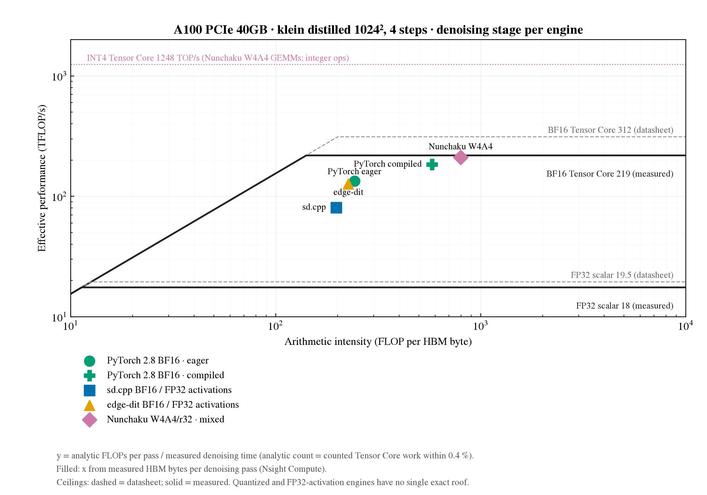

# Compare: measured DRAM traffic and roofline position of the A100 engines' denoising pass

## Question

Where does one denoising pass of each A100 engine sit on a roofline built from measured quantities (DRAM
bytes from Nsight Compute, ceilings from [a100-ceilings-001](a100-ceilings-001.md)), and how far was the earlier
analytic byte estimate off? RQ1: which optimizations change the bottleneck of the denoising stage.

## Runs

| Counter run | Benchmark run (time per pass) | Engine, configuration | What differs |
|---|---|---|---|
| [torch28 eager](../results/runs/a100-flux-klein-torch28-001__profile__20261024-161538/) | [baseline](../results/runs/a100-flux-klein-torch28-001__baseline__20261015-151548/) | PyTorch 2.8, BF16, eager ([record](a100-flux-klein-torch28-001.md)) | reference |
| [compile](../results/runs/a100-flux-klein-compile-001__counters__20261028-200944/) | [baseline](../results/runs/a100-flux-klein-compile-001__baseline__20261015-151740/) | PyTorch 2.8, BF16, `torch.compile` ([record](a100-flux-klein-compile-001.md)) | compiler |
| [sd.cpp](../results/runs/a100-sdcpp-flux-klein-001__counters__20261028-204743/) | [baseline](../results/runs/a100-sdcpp-flux-klein-001__baseline__20261005-220435/) | stable-diffusion.cpp, BF16 weights ([record](a100-sdcpp-flux-klein-001.md)) | engine; FP32 activations |
| [edge-dit](../results/runs/a100-edgedit-flux-klein-001__counters__20261029-033447/) | [baseline](../results/runs/a100-edgedit-flux-klein-001__baseline__20261005-233237/) | edge-dit.cpp, BF16 weights ([record](a100-edgedit-flux-klein-001.md)) | engine; FP32 activations |
| [Nunchaku](../results/runs/a100-nunchaku-flux-klein-001__counters__20261029-001046/) | [baseline](../results/runs/a100-nunchaku-flux-klein-001__baseline__20261011-124123/) | Nunchaku W4A4/r32 ([record](a100-nunchaku-flux-klein-001.md)) | engine; replacement 4-bit checkpoint |

## Matching

Held fixed: A100 PCIe 40GB (`constraint=G` nodes), FLUX.2 klein 4B distilled, 1024², 4 steps, CFG 1, batch 1,
seed 0, one steady denoising pass of the last generation, Nsight Compute kernel replay with no cache flush and
unlocked clocks, the same metric list ([definitions](../wiki/methods/baseline-metrics.md#nsight-compute-engine-counter-captures-a100)).

Confounds (stated, not removed): engine and activation precision differ (sd.cpp and edge-dit keep FP32
activations; Nunchaku is a replacement W4A4 checkpoint whose quality is not matched); the eager capture used
[profile_a100_counters.py](../scripts/profile_a100_counters.py) (NVTX stage labels, one warmed image) while the
others used [profile_engine_counters.py](../scripts/profile_engine_counters.py) (period detection); captures
ran on different nodes. The comparison is of execution structure at fixed analytic work, not of quality-matched
speed.

## Results

Analytic work is 34.82 TFLOP per pass for every engine. Effective TFLOP/s = analytic FLOPs / benchmark time per
pass (template run). Numbers from each run's `profile/counter-summary.json` and
[plot-data.json](../output/roofline-a100-measured/plot-data.json).

| Engine | Kernels / pass | DRAM GB / pass | Measured ÷ analytic bytes | Intensity (FLOP/B) | Benchmark ms / pass | Effective TFLOP/s | Counted ÷ analytic ops |
|---|---:|---:|---:|---:|---:|---:|---:|
| PyTorch eager | 1543 | 143.58 | 6.7× | 242.5 | 259.4 | 134.2 | 1.004 |
| PyTorch compile | 281 | 60.26 | 2.8× | 577.8 | 189.5 | 183.7 | 1.003 |
| sd.cpp | 1081 | 176.85 | 5.0× | 196.9 | 431.4 | 80.7 | 0.909 |
| edge-dit | 787 | 154.11 | 4.4× | 225.9 | 274.0 | 127.1 | 1.003 |
| Nunchaku W4A4 | 711 | 43.64 | 2.7× | 797.9 | 165.8 | 210.0 | 0.024 (INT4 not counted) |

Measured ceilings: 1550.5 GB/s, BF16 Tensor Core 218.6 TFLOP/s (ridge 141 FLOP/B); datasheet 1555 GB/s and
312 TFLOP/s (ridge 201 FLOP/B).

## Findings

- **Measured traffic is 2.7–6.7× the analytic estimate for every engine.** The analytic model counted weights and
  ideal activation reads only; every pass's real traffic is dominated by intermediate tensors. Before
  measurement, all engines appeared at 985–2144 FLOP/B, deep in the compute-bound region; measured, eager PyTorch,
  sd.cpp and edge-dit sit at 197–243 FLOP/B, 0.98–1.21× the datasheet ridge and 1.4–1.7× the measured ridge.
- **`torch.compile` cuts the pass's DRAM traffic 2.4× (143.6 → 60.3 GB) and its launches 5.5× (1543 → 281).**
  Its intensity rises from 243 to 578 FLOP/B, and the compiled pass's time is 70 % GEMM; this is consistent with
  the hypothesis in the eager record that its −21 % comes from fusing low-intensity elementwise kernels.
- **The two GGML engines carry the most traffic** (sd.cpp 176.9 GB, edge-dit 154.1 GB), about two thirds of it in
  elementwise and reduction kernels around BF16 GEMMs on FP32 activations.
- **Nunchaku moves the least data (43.6 GB)** but the counters cannot confirm its work, because INT4 Tensor Core
  operations are outside the counted metrics; its intensity uses the analytic FLOPs.
- Counted Tensor Core + FP32 work matches the analytic FLOPs within 0.4 % for eager PyTorch, compiled PyTorch and
  edge-dit, validating the analytic FLOP count; sd.cpp counts 9 % less (hypothesis: part of its
  work runs in kernels outside the counted families).

## Limits

- Kernel replay serialises kernels and runs each in isolation; summed replay time is 82–89 % of benchmark time per
  pass, so the remainder (launch gaps, CPU work, overlap) is not attributed.
- Bytes are DRAM read + write at the HBM interface; L2 hits are not traffic. Clocks were not locked.
- The sustained BF16 ceiling (218.6) is below what single kernels reach under replay at boost clock
  (eager GEMMs 258–265 TFLOP/s), so the measured roof is a sustained-load roof, not an instantaneous one.
- Precision and checkpoints differ between engines; this does not compare image quality.
- Kernel classes come from name rules; GGML kernel names are less specific than cuBLAS/Triton names.

## Next experiment

- Same capture for the Base workload (50 steps, CFG 4): `configs/ncu/a100-*-base-*-counters.json`.
