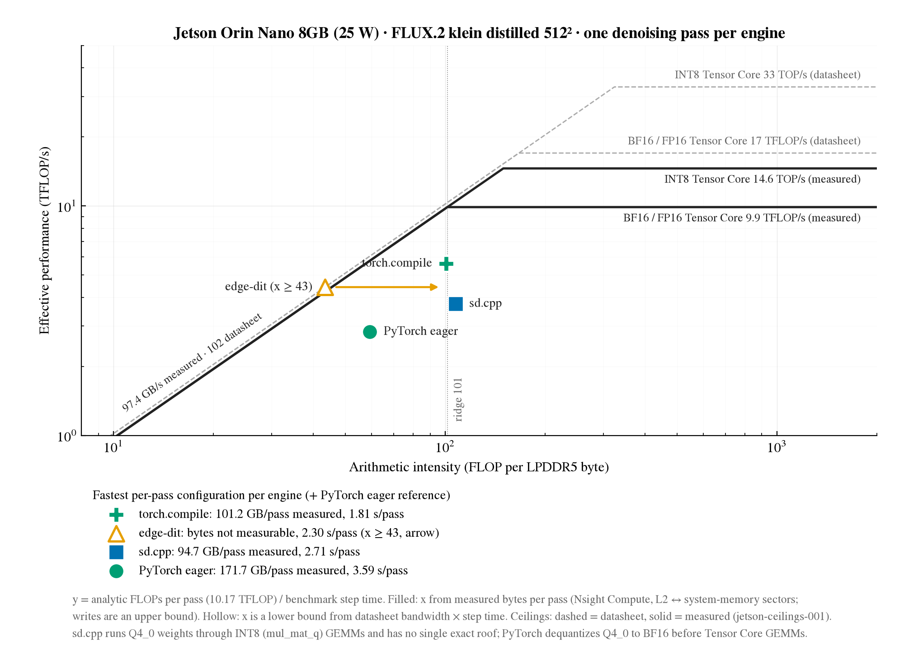
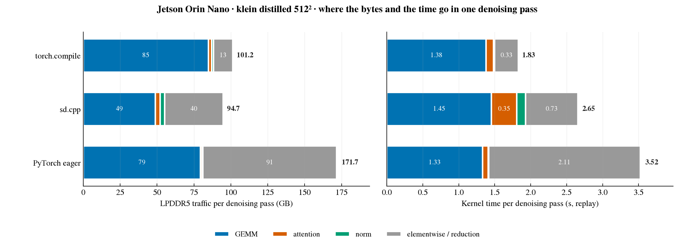
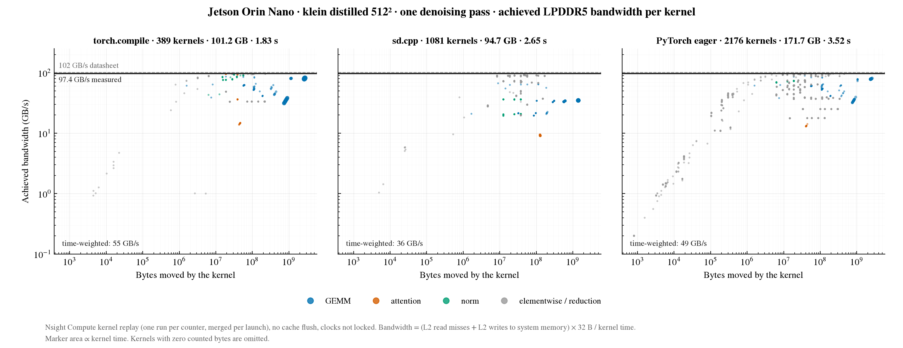

# Compare: measured LPDDR5 traffic and roofline position of the Jetson engines' denoising pass

## Question

Where does one denoising pass of each engine's fastest per-pass configuration on the Jetson Orin Nano sit on a
roofline built from measured quantities (bytes from Nsight Compute, ceilings from
[jetson-ceilings-001](jetson-ceilings-001.md))? RQ1: which optimizations change the bottleneck of the denoising stage.

Selection: per engine, the configuration with the fastest steady denoising pass among those with unchanged output,
plus the PyTorch eager reference. Step caches (EasyCache, MagCache, TaylorSeer) skip whole passes rather than change
a pass, so they do not move a per-pass point and are not in this comparison. sd.cpp variants that only change
loading, prefetch or conditioning reuse run the same pass kernels; the 2026-10-14 repeat is the sd.cpp
template.

## Runs

| Counter run | Benchmark run (time per pass) | Engine, configuration | What differs |
|---|---|---|---|
| [torch.compile](../results/runs/jetson-torch-flux-klein-007__counters__20261101-154131/) | [baseline](../results/runs/jetson-torch-flux-klein-007__baseline__20261015-145234/) | PyTorch, Q4_0 GGUF → BF16, `torch.compile` default mode ([record](jetson-torch-flux-klein-007.md)) | compiler |
| – (failed, [status](../results/runs/jetson-edgedit-flux-klein-006__counters__20261101-152631/status.json)) | [baseline](../results/runs/jetson-edgedit-flux-klein-006__baseline__20261014-170149/) | edge-dit.cpp, Q4_0, all weights resident, flash attention on ([record](jetson-edgedit-flux-klein-006.md)) | engine |
| [sd.cpp](../results/runs/jetson-flux-klein-003__counters__20261030-211513/) | [repeat](../results/runs/jetson-flux-klein-003__repeat__20261014-163411/) | stable-diffusion.cpp, Q4_0, disk-backed, flash attention on ([record](jetson-flux-klein-003.md)) | engine |
| [eager](../results/runs/jetson-torch-flux-klein-004__counters__20261031-002432/) | [baseline](../results/runs/jetson-torch-flux-klein-004__baseline__20261015-141028/) | PyTorch, Q4_0 GGUF → BF16, eager ([record](jetson-torch-flux-klein-004.md)) | reference |

## Matching

Held fixed: Jetson Orin Nano 8GB, 25 W, the same FLUX.2 klein 4B distilled transformer file (Q4_0 GGUF, SHA256
`d1023499…`), 512², 4 steps, CFG 1, batch 1, seed 0, the same prompt, one steady denoising pass of the last
generation, Nsight Compute kernel replay with no cache flush and unlocked clocks, single-counter runs merged per
launch, the same byte counters ([definitions](../wiki/methods/baseline-metrics.md#nsight-compute-engine-counter-captures-jetson)).

Confounds (stated, not removed): the engines run the Q4_0 weights differently (PyTorch unpacks them to BF16 for BF16
Tensor Core GEMMs; sd.cpp multiplies them with Q8_1-quantized activations in integer `mul_mat_q` kernels), so they
do not share one compute roof; the counted Tensor Core types differ (BF16 for PyTorch, FP16 for sd.cpp); the text
encoders differ (NF4 for PyTorch, Q4_K_M for the GGML engines) but are outside the denoising pass. Image quality is
not compared.

## Results

Analytic work is 10.17 TFLOP per pass for every engine. Effective TFLOP/s = analytic FLOPs / benchmark time per
pass. Numbers from each run's `profile/counter-summary.json` and
[plot-data.json](../output/roofline-jetson-measured/plot-data.json) ([script](../scripts/plot_roofline_jetson.py)).

| Engine | Kernels / pass | LPDDR5 GB / pass | Intensity (FLOP/B) | Benchmark ms / pass | Effective TFLOP/s | Average GB/s | Replay ÷ benchmark time | Counted ÷ analytic ops |
|---|---:|---:|---:|---:|---:|---:|---:|---:|
| PyTorch compile | 389 | 101.23 | 100.5 | 1811.7 | 5.62 | 55.9 | 1.01 | 1.002 |
| edge-dit | – | not measured | ≥ 43.4 (bound) | 2296.3 | 4.43 | – | – | – |
| sd.cpp | 1081 | 94.70 | 107.4 | 2713.3 | 3.75 | 34.9 | 0.98 | 0.036 (integer GEMMs not counted) |
| PyTorch eager | 2176 | 171.71 | 59.2 | 3593.1 | 2.83 | 47.8 | 0.98 | 1.002 |

edge-dit's bound: bytes per pass ≤ 102 GB/s (datasheet) × 2.296 s = 234.2 GB, so its intensity is at least
10.17 T / 234.2 GB = 43.4 FLOP/B. Its time per pass is the denoising median / 4 (the run records no per-step times).

Measured ceilings: 97.4 GB/s, BF16 Tensor Core 9.88 TFLOP/s (ridge 101 FLOP/B), INT8 14.57 TOP/s; datasheet
102 GB/s, 17 TFLOP/s, 33 TOP/s.

Bytes and kernel time by kernel class (GB per pass; share of replay kernel time):

| Engine | GEMM | Attention | Norm | Elementwise / reduction |
|---|---|---|---|---|
| PyTorch compile | 84.8 (75 %) | 2.2 (6 %) | 1.2 (1 %) | 13.0 (18 %) |
| sd.cpp | 48.8 (55 %) | 3.2 (13 %) | 3.0 (5 %) | 39.6 (27 %) |
| PyTorch eager | 79.4 (38 %) | 1.0 (2 %) | 0.6 (0 %) | 90.7 (60 %) |

## Findings

- **No engine's pass is at a roof.** The best, compiled PyTorch, reaches 5.62 TFLOP/s at the measured ridge
  (100.5 vs 101 FLOP/B): 57 % of the BF16 ceiling, with 55.9 GB/s average bandwidth, 57 % of the bandwidth ceiling.
  sd.cpp sits at the same intensity (107 FLOP/B) at 3.75 TFLOP/s.
- **`torch.compile` cuts the pass's traffic 1.7× (171.7 → 101.2 GB) and its launches 5.6× (2176 → 389)**, moving it
  from the bandwidth-bound side (59 FLOP/B) to the ridge. The saving is in elementwise work (90.7 → 13.0 GB): the
  Q4_0 unpack chain becomes one fused Triton kernel per weight. GEMM traffic and counted Tensor Core work are unchanged.
- **sd.cpp moves the least data (94.7 GB) but is slower per pass than compiled PyTorch.** Its integer `mul_mat_q`
  GEMMs take 55 % of kernel time at 33 GB/s, against PyTorch's BF16 GEMMs (1.38 s, 84.8 GB). Lower traffic did not give
  a faster pass.
- **edge-dit is the second-fastest pass (2.30 s) but its bytes could not be measured**: Nsight Compute does not fit
  in the memory left by the all-resident configuration (stopped at 243 MB MemAvailable). It is placed at the
  bandwidth bound, ≥ 43 FLOP/B.
- **Replay kernel time equals benchmark time per pass within 2 %** for all three captures. The pass is GPU-bound in
  every engine, so the roofline's y (benchmark time) and the kernel attribution describe the same time.
- Counted BF16 Tensor Core work matches the analytic FLOPs within 0.3 % for both PyTorch captures, validating the
  analytic count at 512²; the sd.cpp count (3.6 %) covers only its FP16 attention.
- Relation to the A100 ([compare-a100-engine-roofline-measured-20261029](compare-a100-engine-roofline-measured-20261029.md);
  qualitative only, because resolution, weights and precision differ): `torch.compile` lowers traffic on both
  devices (A100 143.6 → 60.3 GB, here 171.7 → 101.2 GB). The GGML ordering reverses: on the A100 with BF16 weights and
  FP32 activations sd.cpp has the most traffic, while here with Q4_0 weights it has the least.

## Limits

- Bytes are L2 ↔ system-memory sectors; writes are counted at L2 and are an upper bound on LPDDR5 writes. CPU and
  copy-engine traffic are not included. Clocks were not locked.
- Kernel replay runs each kernel in isolation; overlap between kernels is not represented.
- Each counter comes from a separate run of the same command; the merge requires identical kernel sequences but
  cannot exclude run-to-run variation in a kernel's traffic.
- edge-dit has only a lower bound on x. Its true point lies on the horizontal line at 4.43 TFLOP/s to the right of
  43 FLOP/B.
- Kernel classes come from name rules. In the compiled pass, 55 "attention" launches include Triton kernels fused
  around scaled-dot-product attention, not only the attention kernel.
- No compute roof is exact for sd.cpp (integer GEMMs, FP16 attention, FP32 elementwise work).

## Next experiment

- edge-dit traffic estimate from memory-controller load without a profiler, calibrated against these three captures
  (a `tegrastats` EMC-load sampler; needs a sudo run).
